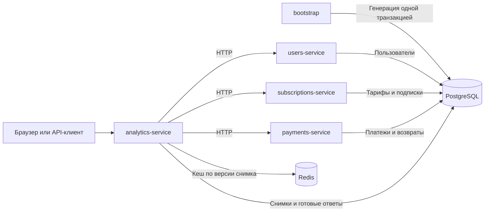
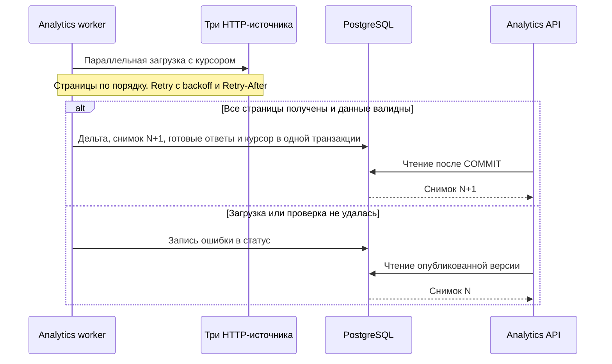

# Аналитика подписок на Go

## Публичный стенд

| Раздел | Ссылки |
|---|---|
| Интерфейс | [Обзор](http://81.26.184.226:8080/#/overview) · [Выручка](http://81.26.184.226:8080/#/revenue) · [Продления](http://81.26.184.226:8080/#/retention) · [Когорты](http://81.26.184.226:8080/#/cohorts) |
| Данные | [Выборка пользователей](http://81.26.184.226:8080/#/users) · [Генератор](http://81.26.184.226:8080/#/generator) · [Источники и снимки](http://81.26.184.226:8080/#/sources) |
| API и состояние | [Swagger](http://81.26.184.226:8080/docs/) · [OpenAPI аналитики](http://81.26.184.226:8080/openapi.json) · [OpenAPI моков](http://81.26.184.226:8080/openapi-mocks.json) · [Статус снимка](http://81.26.184.226:8080/status) · [Healthcheck](http://81.26.184.226:8080/healthz) · [Тарифы](http://81.26.184.226:8080/api/plans) |
| Примеры метрик | [Сводка LTV](http://81.26.184.226:8080/metrics/ltv/summary) · [LTV по тарифам](http://81.26.184.226:8080/metrics/ltv/by-plan) · [LTV по UTM](http://81.26.184.226:8080/metrics/ltv/by-utm) · [Продления месячного тарифа](http://81.26.184.226:8080/metrics/retention?plan_id=monthly) |
| Один пользователь | [LTV по Telegram ID](http://81.26.184.226:8080/users/by-telegram/1000007919/ltv) · [История покупок](http://81.26.184.226:8080/api/users/by-telegram/1000007919/history) · [Пример Excel](http://81.26.184.226:8080/api/reports/export.xlsx?kind=users&user_id=4ee72432-dbf5-4df7-8272-1aa4a228b06f) |
| Панели с учётной записью оператора | [Grafana](http://81.26.184.226:8080/grafana/) · [Цели Prometheus](http://81.26.184.226:8080/prometheus/targets) · [Метрики Prometheus](http://81.26.184.226:8080/metrics) · [pgAdmin](http://81.26.184.226:8080/db/) |

В **Выборке** нажмите на ID, чтобы увидеть, когда пользователь покупал и продлевал подписку. В **Генераторе** можно открыть другой набор по seed. Предпросмотр хранится отдельно от рабочего снимка.

## Локальный запуск

Понадобятся Docker Engine или Docker Desktop и Compose 2.23.1+. Команды выполняются из корня репозитория.

1. При первом запуске скопируйте `.env.example` в `.env`. В Linux и macOS это `cp .env.example .env`, в PowerShell — `Copy-Item .env.example .env`.
2. Замените восемь значений `*_PASSWORD` отдельными паролями. Например, выполните `openssl rand -hex 24` для каждого поля. Для паролей PostgreSQL используйте буквы, цифры, дефис и подчёркивание, чтобы значения подходили для строк подключения. Локальные адреса в шаблоне уже заданы.
3. Запустите стек с панелями мониторинга.

```sh
docker compose --profile observability config --quiet
docker compose --profile observability up --build -d --wait --wait-timeout 300
docker compose ps -a
```

`bootstrap` должен завершиться с кодом `0`. Дождитесь ненулевого `snapshot_id` в `/status`, затем откройте сводку LTV. До первого снимка API метрик возвращает `503` с `Retry-After`.

Локально откройте [приложение](http://localhost:8080/) и [Swagger](http://localhost:8080/docs/). Остальные пути из таблицы выше доступны на том же локальном адресе.

pgAdmin, Grafana и Prometheus запрашивают `OPS_USERNAME` и `OPS_PASSWORD` из `.env` запущенного стенда. Логин по умолчанию — `ops`. На ВМ значения можно посмотреть командой `grep -E '^OPS_(USERNAME|PASSWORD)=' .env`. Если pgAdmin отдельно запросит пароль PostgreSQL, используйте роль `demo_viewer` и `DB_VIEWER_PASSWORD`. `GRAFANA_ADMIN_PASSWORD` относится к внутренней учётной записи Grafana при первой инициализации.

`slog` пишет JSON в stdout. В логах analytics видны HTTP-запросы, публикации снимков и ошибки опроса.

```sh
docker compose logs -f --tail=100 analytics-service
docker compose logs bootstrap
```

`make check` запускает race-тесты с отдельными PostgreSQL и Redis, линтер, проверки фронтенда и Compose. Быстрый прогон Go без БД — `make test-race`. CI поднимает чистый стенд и проверяет его в браузере. Формулы сверяются на наборах с вручную рассчитанным результатом. [Тесты и smoke](docs/TESTING.md)

## Деплой

На ВМ перенесите код и создайте отдельный `.env` со своими паролями. Файл исключён из Git. Для команд Docker на Linux при необходимости используйте `sudo`.

| Доступ | `ANALYTICS_PORT` | `PUBLIC_BASE_URL` |
|---|---|---|
| Локально | `127.0.0.1:8080` | `http://localhost:8080` |
| Проверка по публичному IP ВМ | `0.0.0.0:8080` | `http://<публичный-IP>:8080` |
| HTTPS-прокси на том же хосте | `127.0.0.1:8080` | `https://<ваш-домен>` |

`ANALYTICS_PORT` задаёт привязку порта Docker. `PUBLIC_BASE_URL` — адрес стенда в браузере без завершающего слеша. Для проверки по IP разрешите входящий TCP `8080` со своего IP в группе безопасности ВМ. Для входа в панели через интернет используйте HTTPS.

Выполните `make deploy` или ту же команду Compose, что и для локального запуска. Проверьте с другого устройства `/status` и интерфейс. Готовый снимок имеет `snapshot_id`, после успешного опроса `last_error` равен `null`. Для обновления выполните `git pull --ff-only` и повторите запуск. Существующие volumes сохраняют данные. [HTTPS-прокси, последовательная сборка и ротация паролей](docs/OPERATIONS.md)

## Архитектура



Compose публикует только порт analytics. У каждого Go-сервиса отдельный multi-stage Dockerfile, непривилегированный пользователь в Alpine и healthcheck. SIGTERM отменяет фоновые операции и активные запросы. Analytics отдаёт встроенный React-интерфейс и проксирует Swagger и панели.

### Опрос и публикация



Первый опрос стартует сразу, следующие — каждые 10 минут по умолчанию. Циклы выполняются последовательно. После долгого опроса следующий запуск выравнивается по сетке интервалов. Ошибка видна в `/status`, курсор сохраняется до следующей успешной публикации.

### Чтение и кеш

| Слой | Что хранит или делает |
|---|---|
| PostgreSQL | Снимок, готовые сводки и история пользователя. Данные остаются доступны после рестарта analytics |
| Фильтрованный ответ | Агрегируется из фактов выбранного снимка и кешируется по версии и параметрам |
| `singleflight` | Объединяет одновременные одинаковые запросы в один расчёт |
| Redis | Ускоряет выдачу готовых ответов. При его отказе ответ читается из PostgreSQL |
| HTTP-кеш | `ETag` — номер снимка, `Last-Modified` — его время. При совпадении `If-None-Match` метрики отвечают `304` |

`max-age` — целое число секунд до следующего опроса, от 0 до 600. Во время опроса он равен 0, поскольку снимок может смениться в любой момент. Карточка пользователя и Excel привязаны к версии снимка. После замены версия хранится как минимум 30 минут.

### Почему так

| Решение | Что даёт |
|---|---|
| Один bootstrap и транзакция для трёх моков | Согласованный набор. Внешние ключи проверяют ссылки, генератор и analytics сверяют владельца подписки, цену и связь возврата с оплатой |
| Одна PostgreSQL с четырьмя схемами и разными ролями | Изоляция таблиц в одном хранилище. Analytics получает исходные данные по HTTP и пишет в свою схему |
| Снимок и курсор в одном COMMIT | Видимость только целой версии. После сбоя загрузка продолжается с последнего опубликованного курсора |

[Подробности архитектуры](docs/ARCHITECTURE.md)

## Принятые допущения

### Генерация и импорт

- **Набор.** Seed, версия генератора, размер и фиксированная граница истории определяют данные. Автоматический размер составляет 25 000–100 000 пользователей, при seed 42 получается 31 419. Повторный запуск сохраняет набор. Для нового постоянного набора нужны отдельные volumes.
- **ID.** Используем UUID v4 (порядок записей задают даты, ID воспроизводятся по seed и метке записи). Генератор выставляет биты v4 на основе SHA-256. Telegram ID — уникальный положительный `int64`.
- **Отток.** Базовая вероятность первого продления для периодов 1, 3, 6 и 12 месяцев — 60%, 70%, 76% и 82%. Дальше влияют стаж и склонность пользователя. Доля оставшихся внутри фиксированной когорты сокращается, а условная доля среди дошедших может расти. Фиксированные сценарии гарантируют повторы оплаты, возвраты, смену тарифа, отсутствие оплат и незавершённый период.
- **Дельта.** Страницы с 1 и размером до 1000 возвращают `items` и `has_more`. Сортировка по `(updated_at, id)`, `updated_since` включительно, повтор записи безопасен благодаря upsert по ID. Курсор соответствует началу успешного опроса. Тарифы загружаются целиком. Удаления пока не моделируются. Задержку и доли ошибок можно настроить отдельно для каждого мока.

### LTV, когорты и деньги

- **LTV пользователя** — сумма успешных оплат за всю жизнь за вычетом полных возвратов. Неуспешная попытка даёт ноль. Возврат — отдельная запись, связанная с исходной оплатой, максимум один на платёж.
- **Группировка.** Общая сводка без фильтра по дате включает пользователей без подписок и с нулевым LTV. Тарифная разбивка относит всю выручку к первой подписке по `(started_at, id)`. Переход на другой тариф сохраняет исходную группу.
- **Фильтры.** `from/to` — диапазон UTC `[from, to)` по первой подписке пользователя, в том числе для retention. Платежи выбранного пользователя берутся за всю жизнь. UTM сравнивается с учётом регистра, пробелы по краям удаляются, пустые значения попадают в `unknown`.
- **Валюта и точность.** У тарифов фиксированные цены в RUB. Суммы хранятся в `int64` в минорных единицах. BTC и USDT конвертируются в копейки RUB по сохранённому курсу платежа. Полный возврат использует исходный курс. Курсы моков синтетические. Конвертация округляется один раз до копейки, половина округляется от нуля. Среднее и медиана выдаются строками с двумя знаками в копейках, например `99000.00` означает 990 ₽.

### Продления и зрелость

- **Цепочка.** Учитывается первая цепочка пользователя на каждом тарифе. Новая подписка или пропуск оплаты завершает цепочку. Повторные попытки дают максимум одно продление за период. Поздняя оплата относится к своему периоду. Полный возврат исключает платёж из оплаченных периодов. Оплату подтверждает история платежей.
- **Календарь.** Сроки отсчитываются от даты начала цепочки по календарным месяцам в UTC. День сохраняется, а при коротком месяце ограничивается его концом. Например, 31 января → конец февраля → 31 марта. Строка матрицы обозначает месяц первой подписки пользователя, столбец — номер продления на выбранном тарифе.
- **Граница наблюдений.** `data_as_of` обозначает время опроса. Для зрелости используется `observed_through`. У статического seed это конец сгенерированной истории. Новый бизнес-факт может сдвинуть границу. Повторный опрос тех же записей сам по себе её не меняет.

| Для периода N | Как считаем |
|---|---|
| `eligible` | Непрерывно оплатили N периодов, N-й уже закончился |
| `renewed` | Из `eligible` оплатили следующий непрерывный период |
| `rate` | `renewed / eligible` |
| `cumulative_eligible` | Участники исходной когорты, у которых по времени успели пройти N периодов, включая ушедших раньше |
| `cumulative_rate` | `renewed / cumulative_eligible` |

Если 175 пользователей оплатили третий квартал, а второй оплатили и завершили 239, условная доля — **73,2%**. Если шесть месяцев со старта квартальной цепочки успели пройти у 356 участников исходной когорты, кумулятивная доля — **49,2%**. У неё собственный знаменатель зрелости. При нулевом знаменателе возвращается `null`. `max_periods` по умолчанию равен 12, диапазон — 1–24. [Правила метрик](docs/METRICS.md)

### Контракт API

Метрики и карточки содержат `data_as_of`. Неверный диапазон `from/to` или `max_periods` вне 1–24 даёт `400`. Маршруты, форматы и примеры есть в Swagger.

## Что я бы сделал иначе в продакшене

Сохранил бы Go с `net/http` и `pgx`, точную арифметику, атомарную публикацию снимка и Redis для кеша. Первым шагом подключил бы реальный биллинг и проверил, что расчёты сходятся с реестром оплат.

- **Импорт.** Пагинация по номеру страницы может пропустить запись, если таблица меняется между запросами. В реальных API использовал бы курсор источника и стабильную границу выгрузки. Для API с `updated_at` добавил бы keyset по `(updated_at, id)`, перекрытие окон, upsert и сверку сумм с реестром. Удаления передавал бы отдельными событиями. Для обновлений почти в реальном времени рассмотрел бы transactional outbox, Debezium и Kafka с дедупликацией по ID события. [Debezium Outbox](https://debezium.io/documentation/reference/transformations/outbox-event-router.html)
- **Биллинг.** Хранил бы сумму счёта, версию цены, скидки, частичные возвраты, чарджбэки и фактический FX. Для пробных и бесплатных периодов согласовал бы отдельные правила продления. Зрелость считал бы по минимальной подтверждённой границе полноты источников, чтобы запоздалая оплата не выглядела как отток.
- **Масштаб расчёта.** Сейчас каждый успешный цикл пересобирает снимок целиком. При росте выделил бы факты по пользователям и цепочкам в таблицы, пересчитывал только затронутых дельтой пользователей и обновлял зрелость по границе наблюдений. Тяжёлые Excel-отчёты вынес бы в очередь. Переход к отдельному OLAP-хранилищу оценивал бы после замеров SQL и задержки отчётов.
- **PostgreSQL.** Для отдельной БД аналитики попробовал бы **Supabase как управляемый PostgreSQL**. Оставил бы доступ через `pgx` и отдельные роли. Проверил бы регион и задержку от кластера, доступность PITR на выбранном тарифе и восстановление из бэкапа. Для фонового воркера с advisory lock нужен прямой доступ или session pooler, чтобы блокировка и публикация жили в одной PostgreSQL-сессии. [Подключение](https://supabase.com/docs/guides/database/connecting-to-postgres) · [Резервные копии](https://supabase.com/docs/guides/platform/backups)
- **Kubernetes.** Перенёс бы сервис в кластер, когда нужны несколько узлов и обновления без простоя. API развернул бы как Deployment с несколькими репликами и readiness-проверкой доступности снимка. Опрос вынес бы в отдельный воркер. PostgreSQL advisory lock позволяет выбрать один экземпляр, который публикует снимок, пока API-реплики обслуживают чтение. [Deployments](https://kubernetes.io/docs/concepts/workloads/controllers/deployment/) · [Advisory locks](https://www.postgresql.org/docs/current/explicit-locking.html#ADVISORY-LOCKS)
- **CI и GitOps.** GitHub Actions запускал бы на своих изолированных одноразовых раннерах. После тестов раннер публикует OCI-образ. PR в репозиторий конфигурации меняет digest. После merge **Argo CD** применяет изменение в Kubernetes. Так тот же образ проходит staging и production, а откат делается возвратом предыдущего digest в Git. Миграции БД планировал бы совместимыми с предыдущей версией приложения. [Self-hosted runners](https://docs.github.com/en/actions/reference/runners/self-hosted-runners) · [Argo CD](https://argo-cd.readthedocs.io/en/latest/user-guide/ci_automation/)
- **Метрики.** Использовал бы **VictoriaMetrics** для хранения, `vmagent` для сбора существующих Prometheus-метрик, `vmalert` для правил и Grafana для дашбордов. Начал бы с single-node VictoriaMetrics. Отдельно следил бы за возрастом снимка, ошибками источников и p95 API. `slog` сохранил бы для диагностики по логам, OpenTelemetry добавил бы для трассировки между сервисами. [vmagent](https://docs.victoriametrics.com/victoriametrics/vmagent/) · [Grafana](https://docs.victoriametrics.com/victoriametrics/integrations/grafana/)
- **Доступ.** Подключил бы корпоративный OIDC, роли аналитика и оператора, аудит доступа к истории и лимиты выгрузок. Панели перенёс бы во внутренний ingress. Секреты поставлял бы из хранилища окружения, соединение с PostgreSQL проверял бы через TLS.
- **Проверки.** Добавил бы контрактные тесты против песочницы биллинга и нагрузочные сценарии с `304` и без него. Для формул закрепил бы инварианты. Например, порядок платежей не меняет LTV, а при двух ненулевых знаменателях `cumulative_rate ≤ rate ≤ 1`.

## Ограничения стенда

- **Моки статичны.** После bootstrap источники читают подготовленные записи. Новые платежи и изменения между циклами создаются в интеграционных тестах, где проверяется инкрементальный импорт.
- Попытка, успешная оплата и возврат могут иметь одинаковое время. Telegram ID в генераторе идут с фиксированным шагом.
- Работает один экземпляр analytics. Все четыре сервиса зависят от одного PostgreSQL.
