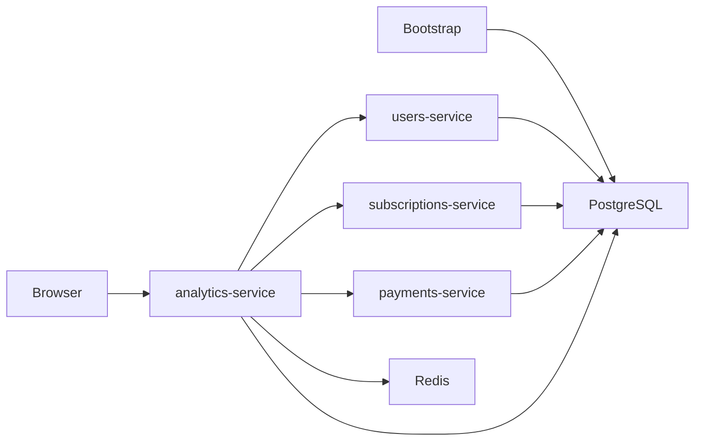

# Архитектура

Каждый Go-сервис и bootstrap собираются своим multi-stage Dockerfile. Compose публикует только порт analytics. Analytics отдаёт встроенный React и проксирует Swagger и панели эксплуатации.

## Данные

Одна БД с четырьмя схемами позволяет bootstrap создать согласованный набор в одной транзакции. PostgreSQL проверяет внешние ключи, а приложение сверяет владельца подписки, сумму и возврат. Сервисные роли имеют доступ к своим схемам. Analytics загружает моки по HTTP.

`SEED`, размер, глубина истории и фиксированная дата определяют набор. `USERS_COUNT=auto` выбирает от 25 000 до 100 000 пользователей из отдельного хеш-потока. Пользователи и платежи имеют воспроизводимые UUID v4, Telegram ID уникальны. Генератор v3 задаёт отдельные вероятности продления для каждого тарифа и учитывает стаж и склонность пользователя. Фиксированные сценарии покрывают повтор оплаты, возврат, смену тарифа, нулевой LTV и незавершённый период.

Bootstrap сохраняет параметры и версию генератора. Повторный запуск с теми же настройками сохраняет набор. Для смены seed создайте отдельный Compose-проект с собственными volumes. Preview генерирует данные в памяти.

## Синхронизация и чтение

1. Analytics параллельно запрашивает источники сразу при старте и затем по `SYNC_INTERVAL`. Страницы одного источника читаются по порядку. Сетевые ошибки, 429 и 5xx обрабатываются через retry с backoff и `Retry-After`.
2. После полной загрузки PostgreSQL сохраняет дельту, проверяет набор и публикует новый снимок, курсор и стандартные ответы одной транзакцией. Ошибка сохраняет прежний снимок. Последующие запросы используют включительную границу `updated_since` и upsert по ID.
3. API выбирает одну версию. Redis хранит готовые ответы этой версии, PostgreSQL остаётся источником снимка и резервным кешем. Новые фильтры агрегируют подготовленные факты. Одинаковые одновременные запросы объединяются через `singleflight`.
4. История покупок записывается при публикации снимка и читается по индексу. Карточка запрашивает ту же версию, которую показала таблица. Для preview история видимых пользователей приходит вместе с результатом генерации.

Активный кеш живёт до успешной публикации следующего снимка. Удаление старых версий начинается через 30 минут после замены. ETag соответствует номеру снимка, Last-Modified — его времени. При совпадении ETag API возвращает 304. `max-age` ограничен 600 секундами и временем до следующего опроса.

Для реальных источников понадобятся устойчивые курсоры, backfill и явная граница наблюдений. При нескольких экземплярах analytics потребуется координация фонового опроса.
